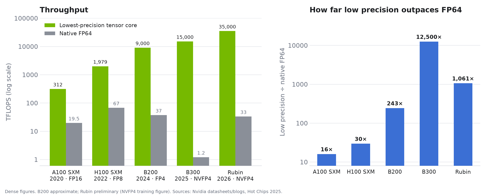
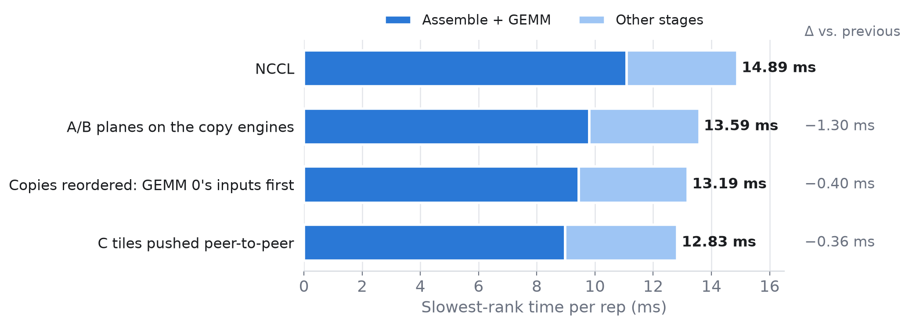

# Node-level Parallelisation of Ozaki Scheme II

Conor McLeod

**Abstract.**
Driven by the AI boom, NVIDIAs newest accelerators increasingly prioritise low precision GEMMs ahead of FP64 GEMMs. 
To keep FP64 GEMMs fast, we look to emulation techniques.
The Ozaki Scheme II is an efficient FP64 GEMM emulation technique which uses the Chinese Remainder Theorem to perform double precision GEMMs on the INT8 tensor cores.
This summer, I worked on a node-level Ozaki scheme library which runs on JUPITER. 

<b>Keywords:</b> GEMM, Ozaki Scheme, Chinese Remainder Theorem

## 1. Introduction

The General Matrix Multiply (GEMM) operation is perhaps the most ubiquitous mathematical operation we perform.
On GPUs, we can perform these operations incredibly fast.

Science and engineering codes have classically operated in the high-precision [FP64](https://en.wikipedia.org/wiki/Double-precision_floating-point_format) regime.
Dense linear algebra solvers, electronic-structure methods in computational chemistry and codes for lattice QCD, material science and mathematical finance all make use of FP64 GEMMs. 
The reason for the FP64 requirement in these applications varies: they might involve ill-conditioned problems, have strict relative error requirements (relative error $< 10^{-15}$), or the computation might be long enough such that that the accumulation of small errors starts to matter. 

Porting science and engineering codes to GPUs, most notably NVIDIA GPUs, has yielded extraordinary returns in performance over the past fifteen years or so.
We have taken for granted that each new GPU generation brings approximately a 2x improvement in FLOPS on FP64.

Today, NVIDIA designs its GPUs for a different market. 
The AI boom has driven unprecedented capital expenditure on accelerators like GPUs and NVIDIA's revenue growth since the boom began has been astounding; NVIDIA data centre revenue was $15 billion in FY2023, $47.5 billion in FY2024, $115.2 billion in FY2025 and $193.7 billion in FY2026.
This revenue growth is driven almost entirely by demand for AI.
As a profit-seeking, publically-listed company, NVIDIA has and will continue to "follow the money", and the shape of their accelerators is changing as a result. 
Unlike much of scientific computing, mainstream deep learning rarely uses FP64.
AI workloads are error tolerant; deep learning uses single precision at most, and with care, much lower precision floating-point formats can be used.
Subsequently, while peak tensor core FLOPs have continued to soar over the last few generations, FP64 performance has actually _fallen_, as NVIDIA prioritises the performance of AI workloads on its GPUs.
The generation-on-generation performance improvements that science and engineering codes have historically taken for granted are now no longer guaranteed. 
Furthemore, "traditional HPC" doesn't have the spending power to compete with AI demand, and thus has limited ability to sway NVIDIA's priorities when designing new chips.

So what can be done about this? 
If we take the changes to the hardware as out of our control, then we must seek software level solutions; that is, somehow emulating FP64 GEMMs using the lower-precision tensor cores. 
The Ozaki Scheme II is one such scheme for emulating FP64 matrix multiplication using the [Chinese Remainder Theorem](https://en.wikipedia.org/wiki/Chinese_remainder_theorem). 

So the need for the Ozaki scheme arises out of  economic factors just as much as scientific ones.
So if science and engineering want to pursue the best high-precision GEMM performance, they must adapt to the way the hardware being designed today.[^1]

Nvidia added FP64 emulation on INT8 tensor cores to cuBLAS in [CUDA Toolkit 13.0 Update 2](https://developer.nvidia.com/blog/unlocking-tensor-core-performance-with-floating-point-emulation-in-cublas/).

## 2. Background 

### 2.1 Chinese Remainder Theroem

The Chinese Remainder Theorem (CRT) says that if you know the remainders of an unknown integer $x$ when divided by each of a set of pairwise coprime integers, then $x$ is uniquely determined modulo the product of those integers.
Its applications include the [Prime-factor FFT algorithm](https://en.wikipedia.org/wiki/Prime-factor_FFT_algorithm) and implementations of [RSA cryptography](https://en.wikipedia.org/wiki/RSA_cryptosystem#Using_the_Chinese_remainder_algorithm).
Roughly speaking, it gives us a way of representing a large integer as a collection of smaller ones, and, crucially, of doing arithmetic on those smaller pieces independently before recombining them.

As a more formal definition, let $x \in \mathbb{Z}$, and let $p_1, \dots, p_N \in \mathbb{N}_{\ge 2}$ be pairwise coprime with $\mathcal{P} := \prod_{i=1}^{N} p_i$.

Let $q_i \in \mathbb{N}$ be the modular inverse of $\dfrac{\mathcal{P}}{p_i}$, such that:

$$
\frac{\mathcal{P}}{p_i}\, q_i \equiv 1 \pmod{p_i}
$$

Suppose $x$ is known only through its residues:

$$
\begin{cases}
x \equiv y_1 \pmod{p_1}, \\
\quad \vdots \\
x \equiv y_N \pmod{p_N}.
\end{cases}
$$

Then $x$ is recovered modulo $\mathcal{P}$:

$$
x \equiv \sum_{i=1}^{N} \frac{\mathcal{P}}{p_i}\, q_i\, y_i \pmod{\mathcal{P}}
$$

This is a **weighted sum** of the residues: each $y_i$ gets a fixed weight $\frac{\mathcal{P}}{p_i}\, q_i$ that depends only on the moduli.

Since residues are only defined up to multiples of their modulus, we are free to choose which representative to use.
Rather than the usual non-negative range $[0, p_i)$, we use the symmetric range $[-p_i/2, p_i/2)$, so each $y_i$ may be negative.
Likewise, the reconstructed value is taken in $[-\mathcal{P}/2, \mathcal{P}/2)$, which lets us represent signed integers $x$ as long as $|x| < \mathcal{P}/2$.

To build intuition for the CRT, the playground below draws each modulus $p_i$ as a small clock whose hand points to the residue $y_i$.
Pressing *reconstruct* accumulates the weighted sum one term at a time on the large clock, which represents $\mathbb{Z}/\mathcal{P}\mathbb{Z}$, until the running sum lands on $x$.
Try increasing $x$ or reducing $N$: once $|x|$ exceeds $\mathcal{P}/2$, the reconstruction wraps around and recovers the wrong value.

<CrtExplorer />

The main takeaways are:
- The moduli are the largest pairwise coprime integers no greater than 256. Keeping them at most 256 means their symmetric residues always fit in int8, and choosing the largest ones maximises $\mathcal{P}$. 
- Using more moduli increases their product $\mathcal{P}$, and thus the range of integers $x$ we can represent.
- Each modulus is close to $2^8$, so it adds roughly 8 bits of range: $N$ moduli represent integers of about $8N$ bits. As we'll see, each extra modulus also costs one extra INT8 matrix multiplication, so $N$ trades accuracy against speed.

### 2.2 Ozaki Scheme II

Armed with an understanding of the Chinese Remainder Theorem, we can now tackle the Ozaki Scheme II. The idea is we can take input FP64 matrices, scale and truncate the values to convert them to large integers, then form matrices of residues for given moduli.
We perform the matrix multiplication on these residues

<OzakiSteps />

### 2.3 INT8 Tensor Cores

Tensor cores are specialised hardware units on Nvidia GPUs for performing matrix multiplication. Tensor cores support different number formats, and the lower the format, the better the performance.

## 3. par_gemmul8

The library I worked on, `par_gemmul8`, is based on [GEMMul8](https://github.com/RIKEN-RCCS/GEMMul8), the Ozaki II library developed by Yuki Uchino et. al., authors of the Ozaki II paper.
Our library builds on GEMMul8, adapting it for JUPITER's 4xGH200 nodes.
The core thesis is that by using the fast interconnects of JUPITER's nodes
For comparison purposes, we vendored the `par_gemmul8` code into our library.
<!--reference the particular commit at which we vendored GEMMul8, since the library has evolved since then-->

## 4. Moving the exchange onto the copy engines

### 4.1 Distributing the work

A JUPITER node has four GH200s, so the library runs one MPI rank per GPU on a 2×2 process grid. Each rank starts with one tile of $A$, $B$ and $C$.

There are two ways to split the work. The reference path (`ref_par_ozaki`) swaps FP64 tiles with its row and column peers, then each rank runs two complete sequential Ozaki multiplications, one per strip of $k$. The faster path (`par_ozaki`) splits the *moduli* rather than the tiles. The $N$ residue GEMMs are independent until the CRT sum, so each rank takes $N/4$ of them. Every rank expands its own tiles into int8 residue planes, sends each peer the planes for that peer's moduli, runs one large GEMM per modulus it owns, and sends the resulting $C$ tiles back to their owners. Each rank then does the CRT reconstruction locally.

Step through both below. Click a rank to see only its traffic.

<TileExchange />

The two all-to-all exchanges, residue planes in and $C$ tiles out, are where the peer copy work comes in.

### 4.2 NCCL competes with the GEMM

Originally both exchanges used NCCL point-to-point `send`/`recv`. To overlap communication with compute, the async path (`par_ozaki_async`) runs the exchange for GEMM $j+1$ while GEMM $j$ is running.

Profiling showed this overlap wasn't happening. On rank 0, `ncclDevKernel_SendRecv` took 43% of the GPU time, more than either GEMM. NCCL moves data with a *kernel*, and kernels need streaming multiprocessors (SMs). The fused CUTLASS GEMM launches 132 blocks, one for each of the GH200's 132 SMs, and assumes it has the whole device. This causes two problems:

- **The GEMM gets slower.** `SendRecv` holds 24 SMs, so 24 GEMM blocks are pushed into a second wave. A GEMM that took 3.1–3.8 ms alone took 4.8–5.1 ms while NCCL shared the device.
- **The exchange stops overlapping.** A communication kernel on an SM makes no progress while the GEMMs keep every SM busy. An exchange that took 1.05 ms on an idle GPU took 4.78 ms here, and it finished only when the GEMM did.

Even a plain `send`/`recv` with no reduction needs SMs, so tuning NCCL can't fix this. The data needs to move without using the SMs at all.

### 4.3 Peer copies

Each GH200 also has **copy engines**: DMA units that move memory independently of the SMs, including to other GPUs over NVLink. A `cudaMemcpyAsync` between two GPUs' memory runs on the copy engines and uses no SMs.

For one GPU to copy into another's buffers, it needs a pointer to them. At startup, each rank exports its workspace allocations as CUDA IPC handles, swaps them with its peers over MPI, and maps the peers' buffers into its own address space. This happens once. After that, the exchange is just `cudaMemcpy2DAsync` calls:

- **A/B planes are pulled.** Each rank reads its peers' int8 planes directly into its own assembled buffer. One strided copy replaces both the NCCL receive into a staging buffer and the unpack step that followed it.
- **C tiles are pushed.** Once GEMM $j$ finishes, each rank writes its peers' $C$ tiles directly into their buffers. The rank doing the GEMM records a local event when it finishes, so it knows when the tiles are ready to send.

NCCL also handled synchronisation between ranks: a sender couldn't get ahead of its matching receiver. A raw copy has no handshake, so that ordering has to be enforced another way. The GPU can't do it without a kernel on an SM, which is exactly what we're trying to avoid, so it moves to the host. Two `MPI_Barrier`s are enough. One, before the loop, stops a rank reading a peer's planes before they're written. The other, after the loop, stops a rank overwriting planes a peer is still reading, and confirms every $C$ tile has arrived. Each barrier sits next to a host sync the code already had, and a 4-rank barrier takes single-digit microseconds.

The feature is opt-in, with `PGEMM_PEER_COPY=1`. It needs all four ranks on one node, each on its own P2P-capable GPU. Otherwise it falls back to NCCL.

### 4.4 Order matters

With the A/B planes on the copy engines, the profiles showed one more problem. Each peer link runs one copy at a time, and the copies were queued as $A_0, A_1, B_0, B_1$. GEMM 0 needs $B_0$, not $A_1$, so $B_0$ waited about 350 µs behind a copy that nothing needed yet. Holding back $A_j$ until $B_{j-1}$ has landed gives the order $A_0, B_0, A_1, B_1$, and GEMM 0 starts about 330 µs earlier. Everything after it moves earlier too.

The timeline below is real Nsight Systems data for the assemble and GEMM stage on one rank. Each button is one commit. The top band shows the SMs, and the bottom band shows the copy engines, with one lane per peer link. Under NCCL the copy engines do nothing, and GEMM 1's inputs can't start moving until GEMM 0's blocks begin to finish. Hover a bar to see its times.

<StageTimeline />

### 4.5 Results

To measure each step, I ran `par_ozaki_async` with $12000^3$ matrices and 8 moduli, interleaving all four builds on **one** node. This mattered: in the GEMMs, one GPU on a node can be 13–15% slower than another, and *which* GPU is slow depends on the node. When my first runs landed on different nodes, this variation was larger than every step except the first. The time shown is for the slowest rank, averaged over two jobs per build.

| Build | Time (ms) | Δ (ms) |
| --- | ---: | ---: |
| NCCL | 14.89 | |
| A/B planes on the copy engines | 13.59 | −1.30 |
| Copies reordered: GEMM 0's inputs first | 13.19 | −0.40 |
| C tiles pushed peer-to-peer | 12.83 | −0.36 |

Overall, the time drops from **14.9 ms to 12.8 ms (−14%)** with the same accuracy (maximum relative error $7.3 \times 10^{-15}$). Each step helps. Two jobs per build isn't a significance test, but the ranges for consecutive builds don't overlap.

The GPU metrics confirm the second-wave effect directly. Under NCCL, each GEMM launch takes 4.36–4.66 M cycles, compared with 3.53–3.63 M with peer copy, about **23% more work** for the same multiplication. NCCL is also noisy. Its two reps differ by 1.2–1.3 ms, compared with 0.01–0.4 ms with peer copy.

## 5. Profile analysis with DuckDB

Due to the nature of the codebase, I was 12 NSight Systems

[DuckDB](https://duckdb.org/) is an in-process analytical database — you can think of it as SQLite3 but for analytics. It has a great CLI and clients for most major languages. The Python client runs DuckDB inside a Python process.

## 6. Conclusion

## Acknowledgements

I would like to thank Clément Richefort for supervising my project.

## References

<ol class="references">
<li>K. Ozaki, T. Ogita, S. Oishi, and S. M. Rump, ‘Error-free transformations of matrix multiplication by using fast routines of matrix multiplication and its applications’, <i>Numer Algor</i>, vol. 59, no. 1, pp. 95–118, Jan. 2012, doi: <a href="https://doi.org/10.1007/s11075-011-9478-1">10.1007/s11075-011-9478-1</a>.</li>
<li>Y. Uchino et al., ‘High-Performance and Power-Efficient Emulation of Matrix Multiplication using INT8 Matrix Engines’, in <i>Proceedings of the SC ’25 Workshops of the International Conference for High Performance Computing, Networking, Storage and Analysis</i>, in ACM Conferences, 2025, pp. 1824–1831. doi: <a href="https://doi.org/10.1145/3731599.3767539">10.1145/3731599.3767539</a>.</li>
</ol>

[^1]: Nvidia have said they are not abandoning the HPC community
